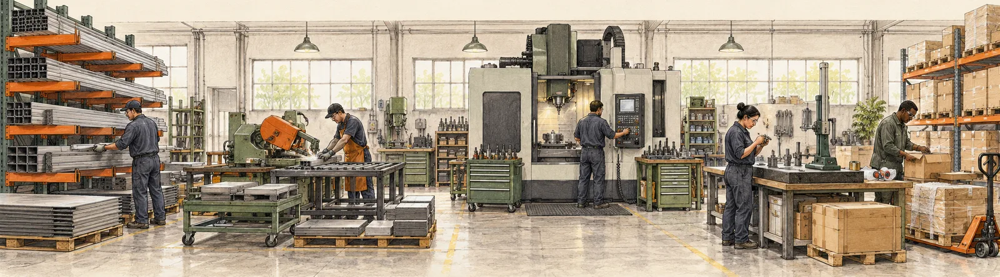

# Where AI Fits

A plain-English guide for factory owners: where AI can help across 24 everyday factory processes, what to ask before buying anything, and how to start small.

**[Open the live site](https://nyn46.github.io/Manufacturing-AI/)** · Made by Nayansi Jain, AI consultant for manufacturing



## What's inside

- **24 processes in 6 departments.** For each one: how the work is done today, where it goes wrong and why, where AI can help, the questions to ask, the records you need, who stays in charge, and what to measure.
- **How the work connects.** A map of how one department's problem travels into the next, with four real-world "chain" stories per industry.
- **Top 10 headaches.** Common factory problems such as breakdowns, defects, planning and paperwork, each linked to the processes behind it.
- **Choose your industry.** Plastics, metal parts, foundry, textiles, food, electronics assembly, and chemicals and paints. The whole site rewords itself to fit, including process names, stories and headaches.
- **Factory AI Readiness Checklist.** 18 yes/no checks that score whether a problem is ready for an AI trial, with steps for how to use it and where AI can help in each section. Use it on screen, or download the blank PDF.
- **Why this matters.** 11 published figures from industry studies and government reports, each linked to its source.
- **AI words in plain English.** A short glossary, so nobody can confuse you in a sales meeting.

The before-and-after stories are illustrations to explain ideas, not results from a specific factory.

## Get in touch

- Email: ainayansi@gmail.com
- Instagram: [@nayansiai](https://www.instagram.com/nayansiai/)

## Run it on your computer

It's a plain website: no installs and no build step.

```sh
git clone https://github.com/nyn46/Manufacturing-AI.git
cd Manufacturing-AI
python -m http.server 8001
```

Then open http://localhost:8001.

## Files

| File | What it holds |
| --- | --- |
| `index.html` | The page shell, top menu and footer |
| `app.js` | Pages, navigation, industry switching and animations |
| `data.js` | Your details, the 10 headaches, glossary and starter steps |
| `research.js` | The 24 processes, 6 departments, industries and sources |
| `connections.js` | Links between processes and the general chain stories |
| `industry-text.js` | Industry-specific wording for every section |
| `checklist.js` | The readiness checklist and scoring bands |
| `stats.js` | The 11 cited figures |
| `style.css`, `research.css` | Look, layout, motion and print styles |
| `assets/` | Illustrations and the checklist PDF |

To change wording, edit the matching `.js` file and push. The live site updates within a minute or two.

## Privacy

There is no login, tracking or server. Your industry choice and checklist ticks are saved only in your own browser.

## Credits

Created by Nayansi Jain. Illustrations were made for this project. Research sources are listed on the site. No open-source licence has been chosen, so please ask before reusing the content.
